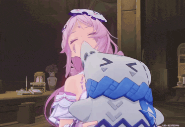

# Kaka Viangi

  

  <em>“Berproses dalam diam, membangun dalam ketenangan.”</em>

  
  
  

---

## About Me

Halo! Saya **Kaka Viangi**, pelajar di **SMK Assalaam Bandung** yang tertarik pada pengembangan web dan aplikasi mobile.

Saya senang membangun antarmuka yang rapi, responsif, dan mudah digunakan. Saat ini, saya terus mengembangkan kemampuan frontend development, UI/UX, serta eksplorasi teknologi baru melalui berbagai proyek.

- **Location:** Bandung, Indonesia
- **Focus:** Frontend Development & UI/UX
- **Email:** [kakaviangi58@gmail.com](mailto:kakaviangi58@gmail.com)

---

## Tech Stack

### Languages

  
  
  
  
  

### Frameworks & Tools

  
  
  
  
  

### Design & Workflow

  
  
  
  
  

---

## GitHub Statistics

  
  

  

---

## Gaming & Interests

Di luar coding, saya juga menikmati game dari HoYoverse:

- Genshin Impact
- Honkai: Star Rail
- Zenless Zone Zero

Saya juga tertarik pada fotografi, desain antarmuka, dan eksplorasi ide kreatif.

---

## Connect With Me

  
  
  
  

  Made with curiosity and consistency · Kaka Viangi

